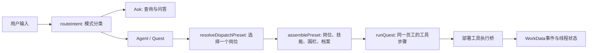
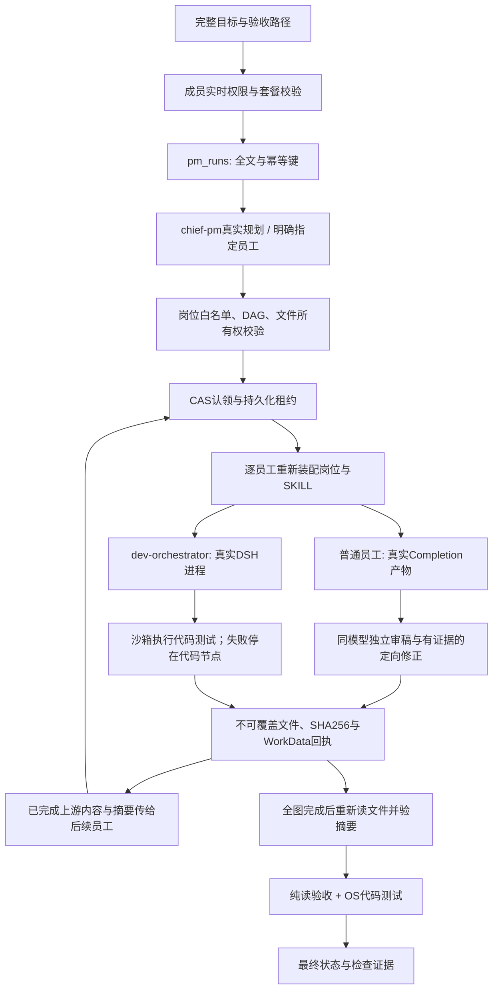

# WorkLoom PM：从目标到交付的实际链路

本文描述本次从 WorkLoom IM `e5d76398484cac7d8ac50b6c27905765a59fd50f` 派生的 PM 产品实现。代码精读证据标为 A，测试与运行回执标为 B，未实测的推断标为 D。真实成绩和失败样本见 [2026-11-03 专项审计](PM-AUDIT-2026-11-03.md)，旧版评测保留在 [PM-EVALUATION.md](PM-EVALUATION.md)。

## 服务对象与需求边界

使用者是提出业务目标的产品负责人，以及需要需求、代码、测试与交付资料的小型研发团队。系统减少三项重复劳动：在角色之间复制上下文、把目标翻译成任务依赖、核对模型声称的完成是否有真实文件和验证依据。[A]

本轮假设为本机单用户、一个独立数据库、合成研发需求，不接生产客户数据。创建接口立即保存并返回，长工作在后台执行；单次计划最多八节点，按拓扑顺序串行执行。多员工协作已经形成真实依赖关系，但不表示并行调度或无限长自治任务。[A]

| 场景 | 用户原有困难 | 本次可检查的行为 |
|---|---|---|
| 定义反馈收集功能 | 想法缺少范围、字段和验收 | 需求岗位输出用户场景、P0/P1/P2、字段与逐例验收 |
| 实现待办模块 | 文档、实现和测试由人手工串联 | 产品经理拆分需求→开发→评测→交付；开发节点读上游文件并写真实模块与测试 |
| 修复版本质量问题 | “测试通过”与真实发布证据混在一起 | 明确模型摘要评审、考试和代码运行的不同证据；缺项停止完成或发布 |

P0 是完整目标、真实分工、岗位装配、限定工具、持久化状态、产物摘要、失败关闭和可回读回执。没有这些行为，用户仍须手工核对每次交付。P1 是更大的真实任务集、跨平台 OS 验证后端与持续质量回归。P2 是经单独权限与连接器验证的外部研发、知识和发布接入。[A/D]

本轮默认不执行生产发布、主干写入、资金、客户外发、真实红队攻击、任意宿主命令或任意互联网项目的依赖安装。其它行业资产完整保留，不能因复制完整就推导其生产连接器已验收。[A]

## 原系统如何处理意图

原链路有一次模式分类和一次岗位选择，职责不同。[A]



`packages/runtime/src/intent.ts` 的 `routeIntent` 可调用 `LlmIntentClassifier`，超时或异常走显式规则回退；`ask/agent/quest/clarify` 只是在决定交互模式。`apps/server/src/runtime/dispatch-routing.ts` 与 `thread-runner.ts` 再根据语义、行业默认、Bundle 编排岗位和兜底选择员工。这不是两遍相同的“理解用户意图”。[A]

AI-PM 工作区另有一套受行业约束的语义路由：需求、竞品、指标、用户反馈、文档、行业、发布、研发、模型、评测、提示词、红队与知识治理目标会先匹配对应员工，`chief-pm` 是未命中具体职责时的产品决策兜底。这些规则只在 `ai-pm` 生效，酒店/视频/增长规则保持原样；路由来源区分 `semantic` 与 `industry-default`，不再把语义命中标成默认岗位。[A+B]

原 AI-PM 包的 `chief-pm` 是 coordinator，原通用缺省选择逻辑优先 orchestrator；因此不能把原通用派遣等同于由产品总监拆分全体研发员工。原 Quest 是一个岗位下的有限顺序工具步骤，未把员工身份与跨岗位依赖作为任务图节点。若部署没有执行桥，部分工具只提供模拟或“未核实”路径，不能从步骤状态推导软件已交付。[A]

历史 FAQ 的 36/36 是 C 端 FAQ 集上的检索成绩，既不是研发岗位召回率，也不是复杂项目端到端达成率。必须另建任务集、明确正确岗位、保留分母和失败样本。[A]

## 新增的 PM 团队层

PC `/development` 的团队页面通过 `/api/pm` 提交完整目标。指定 employee 时跳过收费规划，形成该员工的单节点；未指定时由 `chief-pm` 生成岗位 DAG。它是独立入口，不会默默把旧 IM 的所有聊天任务改为多员工自治。[A]



核心实现位于 `apps/server/src/industry/ai-pm/`：`contract.ts` 管合同，`employees.ts` 验安装与技能摘要，`policy.ts` 管内部沙箱动作与原围栏的合并，`store.ts` 管事务与状态，`artifacts.ts` 管文件，`service.ts` 管调度，`router.ts` 管 HTTP 权限。[A]

每员工收到自己的角色提示、技能正文、完整原目标和已完成祖先的产物内容与 SHA256。只读到了哪个材料、输出了哪个文件，都可以沿依赖和回执追溯。技能文字不会自动变成网络、数据库、shell 或发布权限。当前普通员工生成的是内部文件产物，不等于运行了其 SKILL 中提到的所有原业务 handler。[A]

团队计划通过结构合同后，还须通过岗位所有权复核：代码/测试、评测/坏例、发布/回滚、提示词、红队、竞品、指标、反馈、知识等具有高置信文件名语义的产物不能交给无关员工；可按安全交集自动纠正错配并在 `planningReceipt.ownerCorrections` 留痕。同一任务混入互斥职责、或目标主责员工完全缺席时，在任何员工调用和文件写入前失败关闭。未知文件名不做猜测。[A+B]

规划和员工回执由服务端绑定实际装配的 Bundle 版本、规范化 manifest 摘要、岗位摘要、每份技能及拼接正文摘要；执行器自报的同名来源字段会被移除。全部二十份 AI-PM 技能都须通过对应结构化证据合同，缺少或未知的合同拒绝装配。`3.0.1` 候选源包和 C 端投影的清单摘要同步；PM 团队层在执行时读取并验真源资产，历史数据库回执保留其当时的源摘要。[A+B]

普通员工只有一个 outputRef 时，文件路径由服务端绑定，模型只返回正文，避免长文档在 JSON 包装中重复或截断。多文件任务使用结构化合同；只允许把字符串中原始控制字符做等价 JSON 转义、折叠同路径且逐字节相同的重复副本，并记录原响应、规范化与产物摘要。冲突重复、尾部多余结构、缺括号或 length 截断均拒绝，不猜测补全文本，也不自动付费重试。[A+B]

文本候选经同一 `deepseek-flash` 的独立审稿阶段核对原目标、来源事实、计算、前后口径、验收覆盖和授权回执。审稿启用 `high` 思考并要求完整 JSON；问题必须锚定原要求与产物原句，支持的数值和码点规则再由代码复算。有证据时才修正，最多两次，每次修后再验。审稿保留各阶段计量和摘要，不当作外部事实或独立业务通过证据。[A+B]

## 数据模型与状态

迁移 `packages/db/migrations/0043_pm_team.sql` 新增三张表。[A]

| 表 | 关键字段 | 一致性与索引 |
|---|---|---|
| `pm_runs` | tenant/workspace、完整 goal、idempotency_key、fingerprint、status、model_id、plan_version、planning_receipts、usage、verification、lease | scope+幂等键唯一；scope+created/status 索引；workspace+tenant 复合外键 |
| `pm_tasks` | run/task/scope、ordinal、preset_key、goal、depends_on、acceptance、output_refs、attempt、attempt_receipts、usage、adapter_receipt | run/task/scope 主键，run/ordinal/scope 唯一；任务就绪索引；scope 复合外键 |
| `pm_artifacts` | run/task/scope、path、SHA256、size、media_type、verified_at | run/scope/path 唯一；任务复合外键；禁止更新、删除的 append-only trigger |

三表均 FORCE RLS，同时约束 tenant 和 workspace。HTTP scope 来自已验签会话和实时成员关系，客户端不能指定租户或沙箱根目录。每次业务变更和 WorkData 生命周期事件在同一个事务提交，事件失败则业务回滚。[A+B]

运行状态为 created/planning/running/paused/blocked/failed/completed/cancelled。任务只有 CAS 认领成功才执行；并发开始不会生成第二个 worker。租约过期仅转 paused，恢复需显式触发并重新验证既有完成文件，不静默重发收费请求。代码员工先通过服务端沙箱测试才发布并解锁下游；失败时保留实际观测和用量，恢复只重派未完成的责任节点。下游可引用服务端对具体文件摘要的验证记录。取消与完成加锁串行，取消后的迟到已计费响应只保留计量，不发布产物。[A+B]

文件系统与数据库不共享事务。员工产物先以 no-clobber 文件写入并核验摘要，再由 `completeTask` 提交数据库回执；若后者失败，服务端会重新读取 `pm_artifacts`，仅在数据库确认这些产物未登记且文件哈希仍匹配时清理本次未提交文件。数据库不可回读、产物已登记或文件被替换时一律保留，等待人工对账，避免删除证据，也避免恢复被永久 `EEXIST` 卡死。[A+B]

已知失败用量按 attempt 去重保留，恢复后累计。缺少 usage 的调用不能被伪造为零。物理 API 费用仍以供应商回执和评测代理账本为权威，应用聚合不是供应商账单。[A+B]

## HTTP 合同

所有接口均要求当前工作区有效成员；guest、partner、readonly 被拒。写操作还要求 task.dispatch、workspace.write 与 quest 套餐能力。不会因旧 JWT 声称 owner 就跳过实时权限复核。[A+B]

装配 HTTP 路由本身不会创建数据库池或 worker。服务在实际请求通过成员中间件后才按需创建，并在同一路由实例中复用；未配置数据库也能加载通用认证入口并拒绝匿名 PM 请求。[A+B]

| 方法与路径 | 参数 / 返回 |
|---|---|
| `GET /api/pm/status` | 配置、实际后端、模型、已就绪员工、检查范围和明确边界 |
| `GET /api/pm/runs?limit=20` | 当前 scope 的运行列表 |
| `POST /api/pm/runs` | `{goal,idempotencyKey,employee?,checks?}`；首次201，完全相同幂等200，冲突409；仅创建 |
| `GET /api/pm/runs/:id` | run、tasks、artifacts，以及用量、依赖和各次回执 |
| `POST /api/pm/runs/:id/start` | 空对象；202，后台执行 |
| `POST /api/pm/runs/:id/resume` | 空对象；只允许paused/failed/blocked，先验证已完成产物 |
| `POST /api/pm/runs/:id/cancel` | 空对象；持久化取消，后续禁止发布新文件 |
| `GET /api/pm/runs/:id/artifacts?path=...` | 服务端核验摘要后返回内容、SHA256、大小与任务归属 |

goal 上限32000字符、请求体256KiB、八任务、单员工十二文件、单文件256KiB、单员工总产物1MiB。HTTP checks 只支持 fileExists/fileContains/json 的纯读断言，不能传命令、代码执行器或宿主绝对路径。路径拒绝越界、隐藏目录、符号链接、大小写冲突和目录前缀冲突。[A+B]

常见失败包括 INVALID_INPUT、RUN_STATE_CONFLICT、MODEL_DRIFT、FENCE_REVIEW_REQUIRED、ARTIFACT_HASH_MISMATCH、RUN_CHECK_FAILED、MODEL_BUDGET_EXHAUSTED。5xx 返回可追踪 ref，不直接把底层数据库或配置错误交给浏览器。[A+B]

## DeepSeek Harness 到底负责什么

当前研发节点真实执行仓库锁定的 `@deepseek-ai/dsh@0.2.1-rc.2`，不是把本地 fixture 门禁成绩当作真实模型成绩。该版本于 2026-10-17 发布，发布说明明确适配 `DeepSeek-V4.1-Flash-1017` 与 Search/Fetch API；它仍是 npm `latest` 指向的预发布版本，不能当作不可变最新版本声明。官方发布源为 [DeepSeek Harness Releases](https://github.com/deepseek-ai/deepseek-harness/releases)。[A+B]

`dsh-adapter.ts` 为每员工创建受限 profile、私有目录与会话，模型请求经父进程 CompletionProvider 发出。子进程只有随机 loopback 哨兵，不收到供应商真实 Key。只允许 list_files/read_file/write_file，写入严格限于该任务 outputRefs；不开放 shell、任意抓网页、插件管理、子代理或生产动作。上下游文件与真实 JSONL 会话、结束状态、进程退出和最终文件一并核对。[A+B]

因此，Harness 的位置是**某个员工内部的“模型请求→工具调用→工具结果→下一轮模型”循环**。产品经理决定谁做什么，团队层持有 DAG，Harness 不会天然理解产品组织或接管所有岗位。普通岗位默认走 Completion；只有实际 adapterReceipt 标明 Harness 的节点才算使用了 Harness。[A]

客户端载荷必须包含 DSH 及其完整第三方嵌套、peer 依赖。npm 安装成功和版本字符串都不足以证明可运行；本轮另在实际 runtime stage 运行了受限 CLI 任务。原全局删除 nested node_modules 的打包清理已改为只清 workspace 包内部副本，required peer 由锁与目录门禁验证。[A+B]

## 代码运行与“通过”的含义

生成代码在 macOS Seatbelt 的 deny-default OS profile 下执行，叠加 Node24 权限、清环境、无网络、宿主文件隔离、超时、内存与输出限额。当前支持零依赖 JavaScript；其它代码语言没有对应 OS 验证器时失败关闭，不以文件存在替代运行。macOS `sandbox-exec` 已被系统标为 deprecated；这是本轮本机验收后端，跨平台生产部署需要经过独立验证的容器或 OS 后端。[A+B]

固定 supervisor 不导入项目代码；Node 测试在受限子进程运行。普通 stdout 是不可信日志，不能靠打印 TAP“通过”伪造检查。监督进程消费真正测试事件并以一次性随机回执返回结构化计数，未运行测试、skip-only、取消、超时、输出洪泛或失败均不通过。[A+B]

可信 child preload 在项目导入前锁定断言库、测试断言注册、相关语言对象及内置模块加载出口；真实负向用例覆盖 ESM/CJS 断言替换、反射修改、`Module._load`、builtin cache 和加载 hook。修复前确实出现过错误代码假通过，原回执保留；修复后对应实际断言失败。这是所测攻击向量的回归，不是对任意恶意 JavaScript 的形式化隔离证明，支持范围仍限于已声明的 Node 后端。[A+B/D]

模型生成的测试仍可能遗漏业务要求，因此回执标为 generated。复杂项目另用事先编写、未交给模型改写的 trusted-evaluator 断言验证接口、边界、状态不变性和长目标尾部要求。这个有限任务集的成功不能外推为任意软件均能自主交付。[A+B/D]

## 模型、搜索、预算与恢复

默认请求 ID 是 `deepseek-flash`。官方文档在本轮核实时映射到 V4.1-Flash-1017，别名仍可漂移；每次保留响应 model/id/usage，不把别名写成不可变版本锁。[DeepSeek 官方文档](https://api-docs.deepseek.com/)

Flash 的搜索由显式 function tools 调用 DeepSeek Search/Fetch；Responses 原生 web_search 在 Flash 上被忽略。是否真的搜索要看工具请求与来源回执，不能从模型名字推断。默认 PM 文档员工未自动获得外网搜索权限；基于给定来源包写简报与重新联网核实是两种证据。[Search 文档](https://api-docs.deepseek.com/guides/search/)，[Responses 文档](https://api-docs.deepseek.com/guides/responses_api/)。

DeepSeek 文本入口使用固定的官方 V4.1 请求模板、BPE 词表和协议序列化。系统指令、完整历史、原始材料、工具定义、工具结果和输出格式先进入最终请求，再计算 `min(393216, 1048576 − 完整输入 tokens)`。PM 团队层不再设 96 KiB 模型输入门槛，DSH 子进程使用登记的完整窗口并把实际请求交给父进程复算。未登记的模型、多模态格式或无法完整计量的请求在出站前明确拒绝。HTTP、文件存储和沙箱限制仍独立生效。 [DeepSeek 官方模型与限额](https://api-docs.deepseek.com/quick_start/pricing/)，[固定分词资产与对照](../packages/base/model-router/assets/deepseek-v41/README.md)。[A+B]

评测代理 `scripts/pm-budget-proxy.mjs` 按物理请求留痕，PM 专用账本可单独配置硬总 token 上限。硬额度以完整输入加实际输出上限做安全预占；预测值用于单独的滚动用量管理，供应商回执到达后用真实用量替代预占。前台助手的日硬额度对问答和团队的每个物理请求同样独立预占。用量未知保留原预占，失败或取消也不能推导零费用。相同账本重启不自动释放待核对请求。请求证据保留最终出站 SHA-256、形状、计量和终态，不含原始正文或密钥。[A+B]

仓库中旧 RDAS 兼容模式和历史评测额度保留自己的合同。普通 PM 源码进程不会自动继承验收代理的单任务额度；前台助手使用自身的每日额度。超过真实窗口的输入会明确返回不能容纳；当前没有对任意任务自动拆分和合成的产品能力。[A/D]

客户端包含真实模型适配、默认型号和运行时配置入口，Key 通过启动环境注入。源码、前端资源和可分发载荷不包含本次真实 Key。[A+B]


## PMtest 的 Super-agent 接入

PMtest 保留 PM 的岗位、沙箱和交付回执。事件路由参考 DeepSeek Harness 团队的 [Super-agent 设计](https://mp.weixin.qq.com/s/zoS7GlReWPhfCjENGxXCdg) 与 [公开原型](https://github.com/deepseek-ai/dsh-superagent-prototype/tree/8c32a9dc5d72c033816c6a8110b37f40cf94fba4)，按 WorkLoom 的现有租户权限和事务实现。

- `POST /api/pm/events` 接受 `{kind:"request",eventId,threadId,input:{goal,employee?,checks?,searchQuery?},start?}`。默认接单后自动启动。需要先录入补充时，设 `start:false` 并沿用任务的 `/start` 接口。相同事件可重放，同 ID 换正文或发起人返回 409。
- `{kind:"followup",eventId,threadId,text}` 直达同一活动任务。单轮最多三条，最后一个执行器被认领后返回 409，请在该轮结束后用同一线程 ID 开启下一轮。接单与补充回执均记录到 WorkData。
- `GET /api/pm/threads/:id/events` 提供有界摘要，`GET /api/pm/threads/:id/events/:eventId` 按需读取原文。每条摘要最多 512 个 UTF-8 字节。研发执行器可通过既有 `read_file` 读取本任务长补充的只读副本。普通文档员工使用摘要。
- `searchQuery` 只适合公开检索词，最多 128 个字符。服务器单独调用 DeepSeek Search 和 Fetch，持久保存来源、摘录与摘要。通过 `GET /api/pm/runs/:id/search-evidence` 查看核验结果。PM 的模型凭据和地址可分别通过 `PM_MODEL_API_KEY`、`PM_MODEL_BASE_URL` 注入。与本机预算代理连用时，显式设置 `PM_SEARCH_USE_LOOPBACK=1`，搜索和推理共用同一个本机预算边界。云端推理不持有本机执行器权限。
- Watchdog 是独立进程，以明确配置的单个租户和工作区运行。它通过既有账本事务回收过期租约。有未结算的模型调用时保留阻断状态，否则转为暂停，已核验产物继续保留。恢复由成员触发。轮询失败记错误并继续后续扫描。

```bash
export PM_WATCHDOG_TENANT=demo PM_WATCHDOG_WORKSPACE=ws-aipm-demo
pnpm -C apps/server exec tsx --env-file=../../.env src/industry/ai-pm/watchdog.ts
```

添加 `--once` 可运行一次并读取已处理的租约数量。默认间隔 15 秒，可用 `PM_WATCHDOG_INTERVAL_MS` 配置。搜索结果未知时冻结原尝试，避免自动发起第二次收费请求；查询结果仍可对账，或由成员在原任务结束后发起下一轮。外部渠道接入和多项目调度另有独立授权与交付范围。
